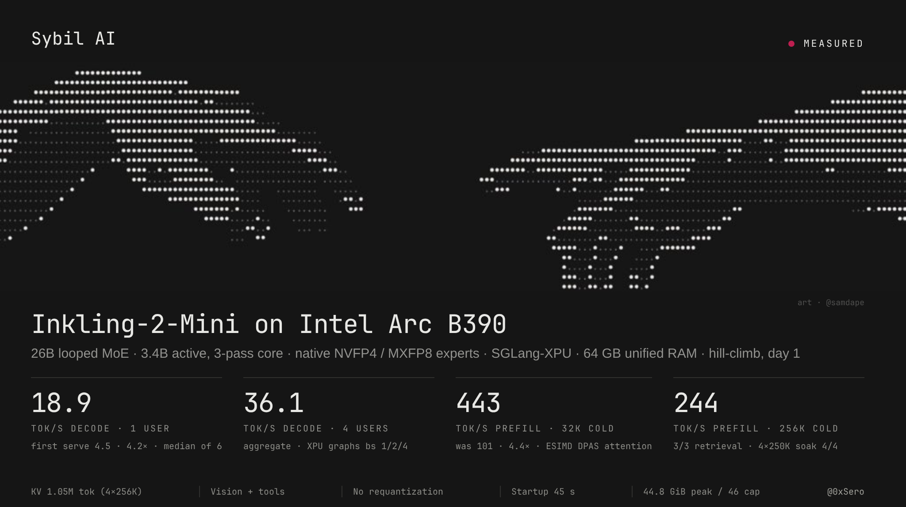

# Inkling-2-Mini on Intel Arc B390 / 64 GB unified memory (SGLang-XPU)



[Editable results card](results-card.html). Card metrics come from the hill-climb harness (medians, cold prefill with
retrieval markers; see [hillclimb-2026-11-21](hillclimb-2026-11-21/README.md)), not from the Lab gates; the Lab proof is
below.

`thinkingmachines/Inkling-2-Mini` (26.4B looped MoE, 128 experts top-8, layers 6–17 run three times per token, hybrid
sliding-window/global attention, 1M native context, image input) served by **SGLang 0.5.20 on Intel XPU** with a
purpose-built model implementation from trellis-serve. The original checkpoint is served as-is: routed experts stay in
their native NVFP4 (layers 0–19) and MXFP8 (layers 20–23) formats; nothing is requantized offline. FP8 E4M3 KV,
262,144-token context, up to four concurrent requests (KV pool 1,052,672 tokens), image input, Inkling reasoning and
tool-call parsers.

Test machine: Dell XPS 14 DA14260, Core Ultra X7 358H, Intel Arc B390 (Xe3), 64 GB LPDDR5X-9600. CPU and GPU share the
same RAM; capacities are not additive. Linux xe driver; Docker with render-node passthrough, bridge networking, 4 GiB
shared memory. No privileged container or host IPC.

## How it works

Upstream SGLang supports Inkling-2-Mini only on CUDA (main + PR #51926: CuTe/Marlin/MegaMoE kernels) and has no XPU
path; neither does vLLM. trellis-serve branch `inkling2-mini-b390` adds an SGLang 0.5.20 model
(`Inkling2LoopForConditionalGeneration`, registered by the exl3xpu SGLang plugin) and XPU kernels:

- **Experts:** SYCL GEMV that decodes NVFP4 / MXFP8 in registers (256-entry SLM byte tables, four rows in flight per
  sub-group): ~110 GB/s on cache-cold weights. Prefill: bf16 dequant + oneDNN GEMMs per expert, one fused SiTU.
- **Dense layers:** INT8 group-32 (fp16 scales) copies for decode through the same GEMV (~100–110 GB/s); bf16 for
  prefill. The LM head is INT8 only.
- **Attention:** Inkling 2 adds a learned relative-position bias inside a 1,024-token band, per-query sink logits, L2
  query/key clipping and log-scaled positions. Decode: SYCL flash-decoding with the bias computed in-kernel, reading the
  paged FP8 pool (global layers) or a model-owned ring (sliding-window layers). Prefill: an ESIMD/DPAS flash-attention
  kernel (generalised from trellis' `fa_esimd.h`) with the bias band, sinks and windows.
- **State:** only the 8 global-attention visits (layers 5, 11×3, 17×3, 23) use SGLang's KV pool. The 40 sliding-window
  visits and the short-convolution histories live in per-request rings keyed by position.
- **Decode graphs:** the decode path is static and capturable (XPU graphs for batch 1, 2, 4); fused Triton kernels for
  the depth-attention mixes, RMS norms, router top-8, short convolutions and attention pre-processing.
- **Vision:** the upstream Inkling 2 vision tower and image processor (vendored, CUDA-only paths unused) with an SGLang
  0.5.20 multimodal processor.

Correctness was checked against an independent PyTorch reference of the forward pass (perplexity 6.77 on 300 tokens;
SGLang model vs reference: mean KL 1.6e-3 prefill / 1.7e-3 decode, top-1 agreement 98%).

## Reproduce

The launch's `build.commit` pins this registry's source tree. From that checkout:

```bash
docker build -f data/sources/inkling2-mini-b390/Dockerfile -t inkling2-b390-recipe .
```

The Dockerfile fetches trellis-serve at `8f8e2fccf0c82c9715b774812f30d9d52f78a5fb` (branch `inkling2-mini-b390`) on the pinned SGLang 0.5.20
XPU base and compiles `_inkling2.so` (SYCL + ESIMD) against its Torch 2.13. Weights: `thinkingmachines/Inkling-2-Mini`
at `ed40e7da625f594fc9c4990f5f66be24873c22d7` (19.5 GB model + tokenizer; `mtp.safetensors` is not used).

`SYCL_CACHE_PERSISTENT` must stay unset/0: with the persistent SYCL program cache the trellis kernels segfault at first
launch (reproduced outside SGLang). The driver-level NEO cache is unaffected.

## Results

Hill-climb harness (`hillclimb-2026-11-21/hc_sgl.py`, final config, 2026-11-21): reasoning effort `none`,
temperature 1.0, decode = median of six streamed 512-token answers, prefill = cold, three hidden retrieval markers.

| Metric | Final | First working build | Method |
|---|---:|---:|---|
| Decode, 1 user | **18.9 tok/s** | 4.5 (eager) | median of 6 |
| Decode, 4 users | **36.1 tok/s** | 35.4 (first graph build) | aggregate, wall clock |
| Prefill 4K / 32K | **396–460 / 443–487 tok/s** | 202 / 101 | cold, two runs |
| Prefill 128K | **322–353 tok/s**, retrieval 3/3 | not practical | 128,237-token prompt |
| Prefill 256K | **244 tok/s**, retrieval 3/3 | not practical | 256,263-token prompt, TTFT 17.5 min |
| Decode at 128K / 256K | 12.0 / 8.6 tok/s | — | after the long prefill |
| Short-prompt TTFT | 0.98 s | 1.8 s | cold, median of 5 |
| Startup to first token | 45 s | — | XPU graph capture included |
| 4-user soak | 4 × ~250K concurrent, 993,237 prompt tokens, **4/4 streams 3/3 retrieval** | — | `soak4_sgl.py` |

The decode ceiling at native weight formats is ~30 tok/s (3.83 GB read per token at the measured 115 GB/s), so c1 sits
at ~65% of it; the rest is mostly small per-layer kernels ([THEORY.md](hillclimb-2026-11-21/THEORY.md)).
Lab acceptance numbers (below) are measured differently: thinking on, first 30 s of an uncapped answer, and prefill as
the whole context request's duration.

## Memory and operational limits

Weights take ~20 GB (native experts 15.9 GB, INT8 + bf16 dense, vision tower) and the FP8 KV pool 16.1 GB
(1,052,672 tokens: four requests at the full 262,144-token context, 16 KiB per token over the 8 global-attention
passes). Sliding-window and short-convolution rings take ~1.2 GB for six request slots. XPU allocations are not visible
in the container's cgroup memory, so the runner sampled xe `drm-resident-gtt` plus cgroup anon: **peak 48.16 GB
(44.9 GiB)** during the Lab, 44.8 GiB during the four-stream soak and 44.7 GiB at a 256K prompt. Declared
`host_ram_gb: 50`; on a 64 GB machine little else should run alongside.

- Prefix (radix) caching is disabled: sliding-window and convolution states are per request. Every new request
  prefills from scratch.
- No speculative decoding. Inkling 2 ships a DSpark block drafter (`mtp.safetensors`); serving it needs SGLang-main's
  DSpark worker and Inkling 2 drafter, which are not in the 0.5.20 XPU stack. This is the largest remaining decode lever.
- A long cold prefill occupies the GPU in 4,096-token chunks; concurrent decoders advance about one step per chunk.
- Let requests finish (or abort them) before stopping the container; do not kill an active worker mid-prefill.
- Optional: `INKLING2_DENSE_FP4=1` stores the dense decode weights as 4-bit (NVFP4-style RTN): decode +11%
  (45.0 vs 50.4 ms/step) at KLD 0.011 vs bf16 (INT8 default: 0.002) over 1,024 tokens. Not part of this recipe.

## Evidence

Acceptance on 2026-11-21 passed all six gates on the source-built image (`lab/lab.py try --on endpoint`,
unmodified): **18.8 tok/s decode** (server tokenizer, first 30 s of an uncapped answer, thinking on) and **265 tok/s
prefill** (the Lab's 184,730-token context request over its 696.7 s). The context answer was `58213`; chat, separated
reasoning (391) and both halves of the tool round-trip passed. The separate image check (solid red PNG, uncapped)
returned `red` with `stop`.

- [Generated recipe](../../../registry/recipes/intel/intel-arc-b390-64gb/inkling-2-mini.sglang.256k.json)
- [Lab run](evidence/lab-run.json), log hash `sha256:0c3bc61b14170ba7`
- [Accepted launch](evidence/accepted-launch.json), SHA256 `274271fe875c53c42381a734e98c81942e4d6b4375801df1e669dc3a09be4180`
- [Vision response](evidence/vision.json), [host memory](evidence/host-memory.json), [server info](evidence/server-info.json),
  [container config](evidence/container.json), [server log](evidence/server.log)
- [Build log](evidence/registry-build.log) (clean build from this registry commit) and [make check](evidence/make-check.log)
- [Hill-climb](hillclimb-2026-11-21/README.md): plan log, ceilings, harness, ledger, soak record, kernel/model tests

Requalify with the unmodified Lab:

```bash
python3 lab/lab.py try \
  thinkingmachines/Inkling-2-Mini@ed40e7da625f594fc9c4990f5f66be24873c22d7 \
  --model inkling-2-mini \
  --engine sglang-inkling-2-mini-nvfp4-fp8kv-256k-b390 \
  --card intel-arc-b390-64gb --on endpoint \
  --endpoint http://127.0.0.1:8000 --gpu 'Intel Arc B390, 64 GB unified RAM'
```
