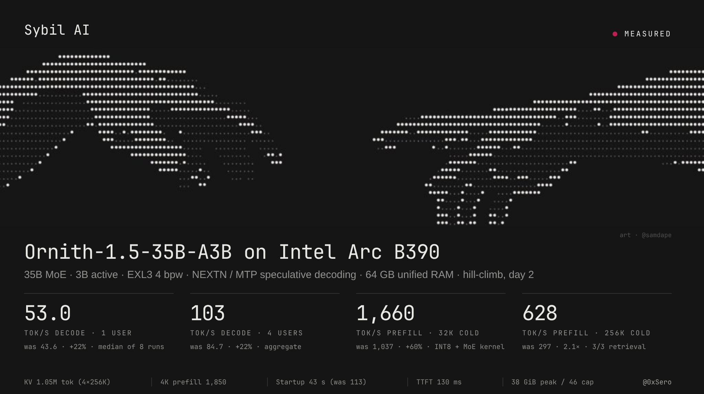

# Ornith 1.5 EXL3 on Intel Arc B390 / 64 GB unified memory



[Editable results card](results-card.html). Layout and dotted-hand artwork follow
[the supplied Sybil AI reference](https://x.com/0xSero/status/2121718629104545980);
the artwork credit to @samdape is retained. Card metrics come from the hill-climb
harness (thinking off, medians of interleaved runs, cold prefill with retrieval
markers; see [hillclimb-2026-11-16](hillclimb-2026-11-16/README.md)), not from the
Lab gates; the Lab proof is below.

Ornith-1.5-35B-A3B, EXL3 4 bpw, FP8 E4M3 KV, 262,144-token context,
one NEXTN/MTP speculative draft with a pruned 256-block draft vocabulary,
on-GPU sampling, INT8 + oneDNN prefill with 4,096-token chunks, image input,
Qwen reasoning/tool parsers and prefix caching. Up to four concurrent requests,
each up to 262,144 tokens (KV pool 1,052,672 tokens).

Test machine: Dell XPS 14 DA14260, Core Ultra X7 358H, Intel Arc B390 (Xe3),
64 GB LPDDR5X-9600. CPU and GPU share the same RAM; capacities are not additive.
Linux xe driver; Docker with render-node passthrough, ordinary bridge networking
and private 2 GiB shared memory. No privileged container or host IPC.

## Reproduce

The launch's `build.commit` pins this registry's source tree. From that checkout:

```bash
docker build -f data/sources/ornith-b390-exl3/Dockerfile -t ornith-b390-recipe .
```

Use `python3 lab/lab.py render <recipe>` or the SDK for the pinned weight
download, environment, arguments and launch command. This is a source-build
recipe, supported by the registry and SDK. The plugin does not export build
recipes; publishing an attested OCI image and rerunning acceptance on that
digest is required before plugin distribution.

The Dockerfile fetches trellis-serve at
`0fab6452b12a7e3f7a4dddf7c70f9dd7b5f0e7ab` (branch `ornith-b390-exl3`), installs
oneDNN 2026.0.2 and compiles three SYCL libraries against the pinned SGLang XPU
base's Torch 2.13: `_C.so`, `_C_dnnl.so` (INT8 prefill GEMMs and oneDNN SDPA) and
`_moe.so` built with 64-row prefill M-blocks (`-DEXL3_MOE_PREFILL_MB=64`, K4 only,
bit-exact against 32-row blocks). That commit contains the K4 grouped MoE decode
and XMX/DPAS prefill kernels that the previous recipe applied as a patch, plus the
`xpu2` GPU sampler (staged top-k with inputs no wider than 2K, since XPU `torch.topk`
crashes on wide inputs) and the pruned draft-vocabulary support.
`draft-vocab-256.json` restricts the MTP draft head to the 256 most-used
128-token vocabulary blocks (32,768 of 248,320 tokens), cutting draft LM-head reads ~7.6x;
the target model still verifies every token against its full vocabulary.
How each setting was chosen, and what was rejected, is in
[hillclimb-2026-11-16](hillclimb-2026-11-16/README.md).

Weights: `ultimatechris/Ornith-1.5-35B-A3B-EXL3-4bpw` at
`6507c778b466b78eaaad0d7d552f98625bd97881`. All routed experts are K4;
the vision encoder remains BF16 and MTP weights are present.

## Memory and operational limits

The 1,052,672-token pool allocates 10.04 GB of target KV and 1.00 GB of MTP KV
(server log), enough for four requests at the full 262,144-token context. Recurrent
state (40 Mamba slots), weights and runtime buffers are separate. Driver-owned XPU
allocations are not reflected in the container's cgroup memory, so the Lab runner
also sampled xe `drm-resident-gtt` over the container's processes plus cgroup anon
memory: peak 39,866,564,608 bytes (37.1 GiB) during the Lab. A separate hill-climb
soak with four concurrent ~248K-token prompts (989,879 prompt tokens) peaked at
36.8 GiB and retrieved all markers in all four streams.

All context tokens, including image tokens and generated output, share the
262,144-token limit. Long cold prefill is slow, and while one request runs a long
cold prefill, other requests' decoding slows to about one step per 4,096-token chunk. Prefix caching avoids repeated
work for matching document prefixes, but does not make a new document cheap.
Image input is tested separately from the maximum-length text test.

A forced container stop during an earlier long prefill caused an xe GPU fault.
Compute recovered after closing the affected processes; no desktop reset or
reboot was used. Let requests finish before stopping/restarting. For cancellation,
use `/abort_request` with `{"abort_all":true}` then POST `/flush_cache?timeout=30`
and wait for it to drain; do not kill an active model worker.

## Evidence

The recipe is generated only by `lab/lab.py try --on endpoint`, using its
unmodified load/chat/reasoning/tools/context/speed gates. Lab responses are
uncapped and run to EOS. The Lab run record is retained here after acceptance.
Original exploratory tuning records, if included, are separate from the Lab
proof: synthetic repeated-word documents, three retrieval markers, thinking
disabled and 256 output tokens per cell. They do not establish general model
quality or controlled FP8-versus-BF16 speed differences.

Acceptance on 2026-11-16 passed all six gates on the source-built image:
**41.0 tok/s decode** (previous recipe 28.6), counted with the server tokenizer over
the first 30 s of an uncapped answer, and **667 tok/s prefill** (previous 255),
measured by the Lab as 213,570 prompt tokens divided by the complete context
request's 320.0 seconds (previous 838.3). The context answer was `58213`; chat,
separated reasoning and both halves of the tool round-trip passed. The additional
image test returned `red` and EOS.

- [Generated recipe](../../../registry/recipes/intel/intel-arc-b390-64gb/ornith-1.5-35b-a3b.sglang.256k.json)
- [Lab run](evidence/lab-run.json), log hash `sha256:108f2fc71ec82e1b`
- [Accepted launch](evidence/accepted-launch.json), SHA256
  `ca655dc5b24142cf5bc42ee4e96edd680f972a8b77777de71c121b1ee112d69e`
- [Vision response](evidence/vision.json)
- [Host memory](evidence/host-memory.json): MemAvailable fell from
  34,885,373,952 to 13,147,111,424 bytes, a 21,738,262,528-byte peak drop
  (GPU residency is only partly visible to MemAvailable; see the GTT figure above).
  The declared 48 GB available-RAM budget covers the 37.1 GiB (39.9 GB) GTT-plus-anon peak.
- [Build log](evidence/registry-build.log) and [server log](evidence/server.log)
- Files beginning `tuning-` retain the earlier exploratory runs, which were
  made before clean-build Lab acceptance and are not the recipe's gate proof.

The exact recipe can be requalified with the unmodified Lab:

```bash
python3 lab/lab.py try \
  ultimatechris/Ornith-1.5-35B-A3B-EXL3-4bpw@6507c778b466b78eaaad0d7d552f98625bd97881 \
  --model ornith-1.5-35b-a3b \
  --engine sglang-ornith-1.5-35b-a3b-exl3-4bpw-fp8-mtp-256k-b390 \
  --card intel-arc-b390-64gb --on endpoint \
  --endpoint http://127.0.0.1:8000 --gpu 'Intel Arc B390, 64 GB unified RAM'
```
