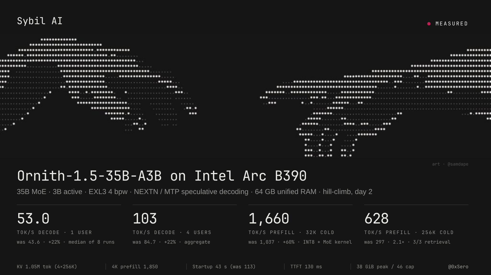

# Ornith-1.5-35B-A3B on Arc B390 — hill-climbed recipe (2026-11-16)

Successor to the Lab-validated recipe in `../` (registry launch
`sglang-ornith-1.5-35b-a3b-exl3-4bpw-fp8-mtp-256k-b390`). Same weights, model and
context (262,144). **Not yet registered as a launch:** the new kernels are an uncommitted
trellis-serve patch, so the registry source build cannot reproduce them yet. Next step: land
the patch, rebuild from the pinned source, re-run the Lab, then update the launch entry.

## Results (Intel Arc B390, 64 GB LPDDR5X, AC power, performance profile)

| Metric | Registered recipe | Hill-climbed |
|---|---:|---:|
| Decode, 1 user | 43.6 tok/s | **53.0** (median of 8 runs) |
| Decode, 4 users aggregate | 84.7 (needs max-running 4) | **103** |
| Prefill 4K / 32K | 1,341 / 1,037 | **1,850 / 1,660** |
| Prefill 128K / 256K cold | 521 / 297 | **980 / 628** (3/3 retrieval at 258,417 tok) |
| TTFT, 256K prompt | 14 m 40 s | 6 m 51 s |
| TTFT, short prompt | 148 ms | ~130 ms |
| KV pool | 264K tokens, 1 request | **1,048,576 tokens, 4 × 256K** (soak: 4/4 retrieval) |
| Startup | 113 s | 43 s (persistent SYCL/NEO/inductor caches) |
| Peak footprint (GTT + anon) | ~31 GiB | 38.1 GiB (cap 46) |

The 256K figures are single cold runs; others are medians of interleaved runs (run-to-run noise ±5–8%).

## What changed
- Pruned 256-bucket draft vocabulary for the MTP head (`dv256.json`, `EXL3_DRAFT_VOCAB`): c1 +14%.
- On-GPU 3-stage sampler (`EXL3_SGL_SAMPLE_DEVICE=xpu2`; avoids XPU `torch.topk` segfaults on wide inputs): c1 +10%.
- INT8 prefill GEMMs + oneDNN SDPA (oneDNN 2026.0.2 build, `_C_dnnl.so`), 4096-token chunks: 32K +50%, 256K 2×.
- MoE prefill DPAS kernel with 64-row M-blocks (`-DEXL3_MOE_PREFILL_MB=64`, K=4 only; bit-exact vs MB32): +7% prefill.
- `EXL3_TARGET_THREADS(_MB16)=256` tuned for Xe3 (defaults came from a larger card).
- `--max-mamba-cache-size 40`, `--max-running-requests 4`, `--max-total-tokens 1048576`.
- Fix: fused K4 GEMV split-K partials need L1-uncached stores + `fence(clean)` on Xe3 (correctness; fused path stays off).

Rejected (measured, no gain): 2–3 MTP drafts (Ornith-1.5 MTP accepts ~14% at depth 2), fused GEMV,
shared-expert fusion, MoE staging, device expert arena, chunk 1K/2K/8K, mixed chunk, prefill graphs, FP8 Q.
Full log in `PLAN.md`; bandwidth/compute ceilings in `THEORY.md`.

## Files
- `trellis-serve-hillclimb.patch` — applies on trellis-serve commit in `trellis-serve.base-commit`.
- `images/` — `Dockerfile.dnnl` (oneDNN 2026 base), `Dockerfile` (plugin + dv256), `Dockerfile.mb64` (MB64 `_moe.so`, built by `scripts/build_and_test.sh`).
- `configs/final-best.json` — env + args; `configs/run-best.sh` — launcher (port 8000, `ornith-1.5-35b-a3b`).
- `scripts/` — hill-climb harness (`hc.py`), queue, footprint probe (`stackmem.sh`, needs `SUDO_PASS_FILE`), soak/equivalence/profile tools.
- `evidence/` — ledger of all runs, 256K gate log, 4×256K soak.

Known limitation: a long cold prefill starves concurrent decoders (~1 decode step per 4096-token chunk).
Drain requests before stopping the container.
